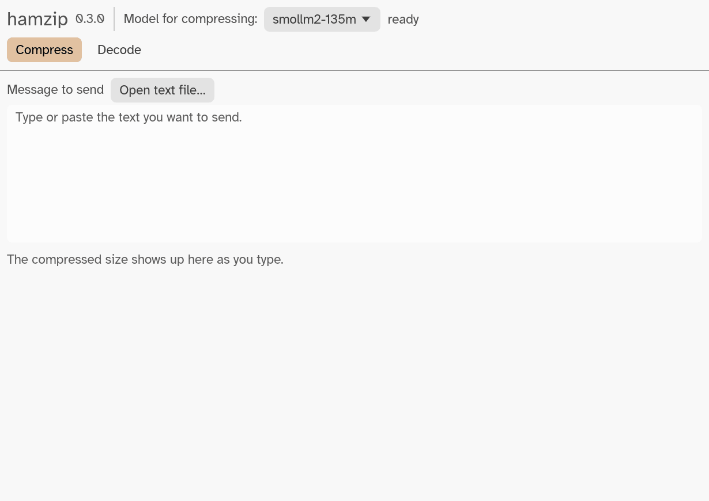
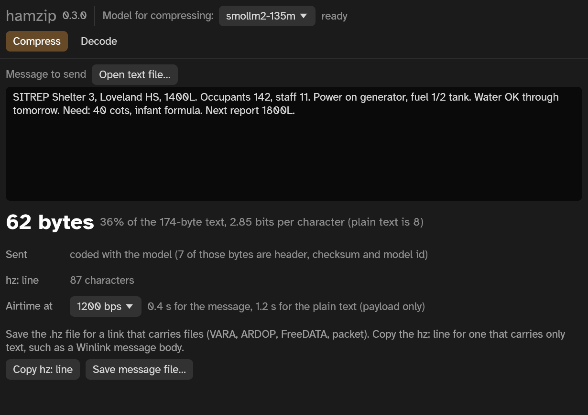
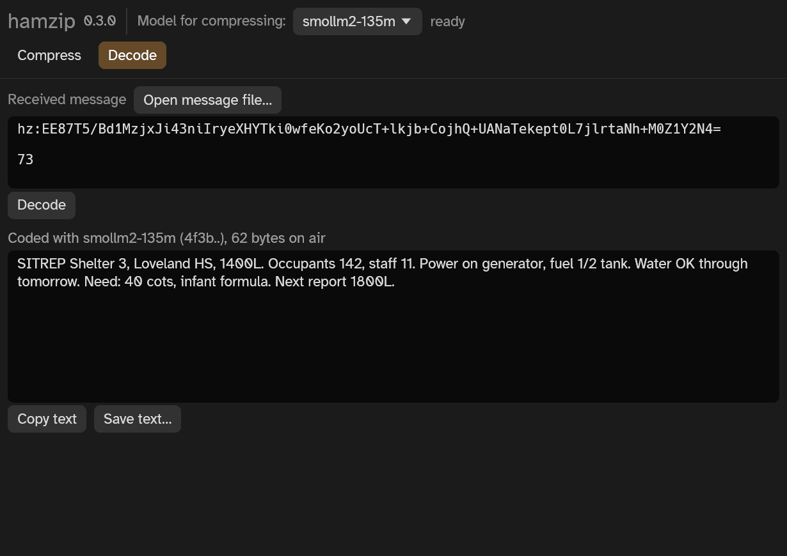

<h1 align="center">hamzip</h1>

<p align="center"><b>Short text messages go over a slow radio link in about a third of the bits.</b></p>

<p align="center">
  <a href="https://github.com/Londopy/hamzip/actions/workflows/ci.yml"></a>
  <a href="https://github.com/Londopy/hamzip/actions/workflows/determinism.yml"></a>
  <a href="https://github.com/Londopy/hamzip/releases/latest"></a>
  <a href="https://github.com/Londopy/hamzip/releases/latest"></a>
  <a href="https://github.com/Londopy/hamzip/releases"></a>
  <a href="CHANGELOG.md"></a>
  <br>
  <a href="#license"></a>
  <a href="https://www.rust-lang.org"></a>
  <a href="#install"></a>
  <a href="#how-is-this-different-from-zip-or-zstd"></a>
  <a href="#choosing-a-model"></a>
  <a href="docs/determinism.md"></a>
</p>

<p align="center">
  
</p>

Both stations keep the same small open language model. The sender uses it to predict each next word piece and spends very few bits on the likely ones; the receiver runs the same model and reverses it exactly. What comes out is an ordinary binary payload, so it rides on VARA, ARDOP, packet or FreeDATA without touching the modem.

## Quick start

```bash
hamzip model download                  # once per station, 137 MB
hamzip encode sitrep.txt -o sitrep.hz  # send sitrep.hz as a binary attachment
hamzip decode sitrep.hz                # on the other end
```

```console
SITREP Shelter 3, Loveland HS, 1400L. Occupants 142, staff 11. Power on generator,
fuel 1/2 tank. Water OK through tomorrow. Need: 40 cots, infant formula. Next report 1800L.
```

That message is 174 bytes as text and 62 as a hamzip message. Rather click than type? The window, hamzip-gui, does the same (see [The window](#the-window)).

## Features

- 📉 **About 2.6 bits per character**, framing included, or 2.3 with the larger model. Plain text is 8, and zstd with a dictionary trained on the same kind of traffic gets about 5.
- 🎯 **Bit-identical across machines.** The model runs on integer arithmetic only, so every computer works out exactly the same probabilities. One different probability would turn the rest of a message into garbage, which is why no floating point is involved anywhere in the coding path. So far that has been checked on 64- and 32-bit Windows, x86-64 Linux and 64-bit ARM Linux, but not on a real Raspberry Pi ([docs/determinism.md](docs/determinism.md)).
- ✅ **Wrong model, no wrong text.** Every message carries a CRC-32 of the text, and model-coded ones carry two bytes of the model's SHA-256. A station with a different model gets an error naming both, never garbled text.
- 🔀 **Picks the smallest form.** Short or odd text falls back to zstd or plain bytes automatically. One header byte says which.
- 📋 **Text-only channels too.** `--text` writes the message as one `hz:` line you can paste into a Winlink message body.
- 🪟 **A desktop window** for anyone who'd rather not use a command line: live size and airtime as you type, copy the `hz:` line, decode a pasted transcript, download models.
- 📖 **Nothing secret.** The format, the arithmetic and the model are published, so anyone can decode what they hear (see [On the air](#on-the-air)).

<details>
<summary><b>More on the hz: text form</b></summary>

For channels that deliver text intact but not files, such as a Winlink message body, `--text` writes the message as a line of `hz:` base64. Base64 is a third longer than the binary message, so a message of a few hundred characters comes out at a little under half its length (a median 45% on the test corpus). Short ones gain less, and hamzip tells you when sending the text as it is would be shorter.

The mode has to pass both cases, digits, `+`, `/`, `=` and `:`, which rules out JS8Call's restricted alphabet. Over a keyboard mode without ARQ (most fldigi modes), a single wrong character makes the message undecodable; the CRC tells you, but nothing can recover it, so use those only with an ARQ layer such as FLARQ.

</details>

## Install

Every [release](https://github.com/Londopy/hamzip/releases/latest) has the same set of downloads. On Windows, take the installer unless you have a reason not to.

| Download | What it is |
|---|---|
| `hamzip-<version>-setup-x64.exe` | **Installer (recommended).** Per-user, no admin prompt. Puts the window in the Start menu as "hamzip" and adds the `hamzip` command to your PATH. |
| `hamzip-<version>-x64.msi` (also `x86`, `arm64`) | MSI installer. Per-user by default; can be deployed machine-wide. |
| `hamzip-v<version>-x64-portable.exe` (also `x86`, `arm64`) | The command line, one exe, nothing to install. |
| `hamzip-gui-v<version>-x64-portable.exe` (also `x86`, `arm64`) | The window, one exe, nothing to install. |
| `hamzip-v<version>-portable.zip` | Both programs for all three Windows architectures; the model and data stay next to the exe. |
| `hamzip-v<version>-linux-aarch64` (also `armv7`, `x86_64`) | Linux command line. `aarch64` for 64-bit Raspberry Pi OS, `armv7` for 32-bit. |
| `hamzip-gui-v<version>-linux-aarch64` (also `x86_64`) | The window for Linux desktops. 32-bit ARM has the command line only. |
| `install.ps1` / `install.cmd` | Script install that picks the right Windows build and checks its SHA-256. |
| `<file>.torrent` / magnet link | Each download over BitTorrent; downloads straight from GitHub even with no seeders. |

**PowerShell one-liner:**

```powershell
irm https://github.com/Londopy/hamzip/releases/latest/download/install.ps1 | iex
```

**Raspberry Pi or other Linux** (swap in the current version, and `armv7` on 32-bit Raspberry Pi OS):

```bash
curl -LO https://github.com/Londopy/hamzip/releases/download/v0.3.0/hamzip-v0.3.0-linux-aarch64
chmod +x hamzip-v0.3.0-linux-aarch64 && sudo mv hamzip-v0.3.0-linux-aarch64 /usr/local/bin/hamzip
```

The Linux binaries need glibc 2.35 or newer (Raspberry Pi OS bookworm, Ubuntu 22.04, Debian 12). On bullseye or older, [build from source](#building-from-source).

**Then get the model**, on every station:

```bash
hamzip model download
```

That fetches `smollm2-135m.hzm` (137 MB) and refuses to keep it unless its SHA-256 is `4f3b006a37c45d5f7ac496eba7bae7deef47661feeed1891b3340e18b4b9c919`. Do it once while you have internet; hamzip itself never needs a connection after that. For the larger, slower model that makes messages about 8% smaller, also run `hamzip model download smollm2-360m` (365 MB, see [Choosing a model](#choosing-a-model)). The window has a **Download** button that does the same.

<details>
<summary><b>Checksums, unsigned binaries and updates</b></summary>

The binaries are not code-signed, so Windows SmartScreen may warn on first run. Every release ships `SHA256SUMS.txt`; check a download with `(Get-FileHash .\<file> -Algorithm SHA256).Hash` on Windows or `sha256sum -c SHA256SUMS.txt --ignore-missing` on Linux.

`hamzip upgrade` replaces hamzip, and hamzip-gui beside it, with the latest release. It checks every new build against `SHA256SUMS.txt` and asks before it replaces anything, then test-starts each new build and replaces both programs or neither. The window offers the same when an update is out. Once a day, when you run hamzip in a terminal with internet, it mentions a newer version on stderr; set `HAMZIP_NO_UPDATE_CHECK=1` to turn that off.

</details>

## Usage

```bash
hamzip encode message.txt -o message.hz     # or pipe: hamzip encode < message.txt > message.hz
hamzip decode message.hz                    # prints the text
hamzip decode message.hz -o message.txt
hamzip info message.hz                      # mode, size and model, without decoding
hamzip bench <folder>                       # encode and decode every file in a folder: sizes, speed, digest
```

Send the `.hz` file as a binary payload or attachment with whatever you already use, and the receiving station runs `hamzip decode` on it. `hamzip bench` is also how two stations check they agree (see [Checking two stations agree](#checking-two-stations-agree)).

For a text-only mode, add `--text` and paste the line it prints. `decode` and `info` take the line, or a whole received transcript holding it, even if the mode wrapped it over several lines:

```console
$ hamzip encode letter.txt --text
hz:EE87/1zQWBJVi5CO8FmpYaBUv3bLpQryNOtZdUT6hx30E3QLTO/QcM8n26O1gvIH++u6xQtTrmTomb26GlzKSDGcGUCVq5Eru+c=
```

That's a 271-character message in 103 characters of text. Leave a blank line between it and your sign-off, since a callsign or "73" on the next line looks like more of the message.

> [!TIP]
> In PowerShell, use the file arguments and `-o` rather than `<` and `>`. Windows PowerShell 5.1 re-encodes piped output as UTF-16, which turns a message into something hamzip can't read.

**Which transport?** hamzip helps most where you control the payload byte for byte: FreeDATA, ARDOP or VARA sessions between your own programs, and packet. Winlink should work with the `.hz` file attached, but Winlink already compresses message bodies and adds its own headers, so the saving on a short Winlink message will be smaller than the numbers below. None of these has been tested on the air with hamzip yet.

## The window

hamzip-gui (Start menu: hamzip) has two tabs:

| Tab | What you do there |
|---|---|
| **Compress** | Type or paste a message, or open a text file. As you type it shows how the message would go out (model, zstd or plain text), its size against the plain text, bits per character, the length of its `hz:` line, and the airtime at a link speed you pick, for the payload alone. **Copy hz: line** puts the line on the clipboard; **Save message file** writes the binary `.hz`. |
| **Decode** | Paste a received `hz:` line, or the whole transcript around it, or open a `.hz` file. It decodes with whichever installed model the message names and shows the text, which you can copy or save. |

The top bar picks the model to compress with and shows whether it's loading, ready, or not downloaded yet, with a **Download** button and progress. The window follows your system's light or dark setting and shares the library, models and data folder with the command line, so anything one writes, the other can read.

<details>
<summary><b>More screenshots</b></summary>

<p align="center">
  
  <br><br>
  
</p>

</details>

## How is this different from zip or zstd?

General-purpose compressors learn from the message itself, and a 300-character message doesn't give them much to learn from. hamzip brings what it knows about English from the model.

Measured on 132 held-out messages from the test corpus (Winlink-style email, ICS-213 forms, radiograms, net reports and SITREPs, written for this project), median bits per character, framing included:

| Method | All messages | 100 to 500 characters | Size vs. plain text |
|---|---|---|---|
| Plain text | 8.00 | 8.00 | 100% |
| deflate (zip, gzip) | 6.22 | 6.25 | 78% |
| zstd -19 with a 16 KB dictionary trained on the rest of the corpus | 4.96 | 5.00 | 62% |
| **hamzip, smollm2-135m** (default) | **2.58** | **2.64** | **32%** |
| **hamzip, smollm2-360m** | **2.34** | **2.43** | **29%** |

Ordinary email and ICS-213 text does best, around 1.8 to 2 bits per character before framing. Callsign lists, grid squares and numbers cost more, about 3 to 3.5, because nothing can predict a callsign it has never seen. The corpus is synthetic, so expect different numbers on your own traffic; `tools/bench.py` reproduces the table.

> [!NOTE]
> The design notes this project started from aimed for under 1.5 bits per character on 100 to 500 character messages. Neither model gets there: they reach 2.41 and 2.18 before framing, 2.64 and 2.43 with it. A model small enough for a laptop (under about 500 MB) doesn't predict callsigns, numbers and terse traffic well enough, and the remaining options, a much larger model or one fine-tuned on a large body of real traffic, are out of reach for now.

<details>
<summary><b>Speed</b></summary>

On a Core Ultra 9 laptop with the default model, hamzip encodes about 450 to 650 tokens a second and decodes 100 to 110, so a typical 300-character message takes about a second to decode; smollm2-360m decodes at about half that. Decoding has to run one token at a time, and most of its time goes to coordinating threads over many small matrix multiplies, so more cores don't help much.

110 tokens a second is about 700 bits of compressed message per second (about 350 with smollm2-360m). On a link slower than that, which covers most HF, hamzip decodes faster than the radio delivers. On a faster one, such as VARA FM, it doesn't, and a long message waits on the decoder; a short one still decodes in about a second. A Raspberry Pi hasn't been measured; expect it to be slower than this laptop, and measure yours with `hamzip bench`.

</details>

### Choosing a model

Both stations need the same model; every model-coded message names the one it was coded with.

| | smollm2-135m (default) | smollm2-360m |
|---|---|---|
| Download | 137 MB | 365 MB |
| Memory while running | about 290 MB | about 740 MB |
| Size on 100 to 500 character text | 2.64 bits per character | 2.43, about 8% smaller |
| Decode speed (Core Ultra 9 laptop) | about 100 to 110 tokens a second | about half that |
| Checked bit for bit on | Windows (64- and 32-bit), x86-64 Linux, 64-bit ARM Linux | 64-bit Windows, x86-64 Linux, 64-bit ARM Linux |

On a typical 174-character SITREP the larger model saves 5 bytes and takes 0.8 seconds longer to decode, so it only pays off in total time on links slower than roughly 50 bits per second. It can still be worth it where airtime on a shared frequency is what's scarce:

```bash
hamzip model download smollm2-360m
hamzip --model smollm2-360m encode message.txt -o message.hz
```

`decode` and `info` pick whichever installed model a message needs, so a station can keep both; `hamzip model list` shows what's installed.

## On the air

In the US, Part 97 forbids messages encoded to obscure their meaning (97.113(a)(4)) and allows only publicly documented codes (97.309(a)(4)). hamzip is compression, not encryption, and everything needed to decode it is public: this repository, the model file and its hash, [the message format](docs/wire-format.md), [the model file format](docs/model-format.md) and [the exact arithmetic](docs/engine.md). Whether publishing a model file counts as public documentation hasn't been tested with the FCC; read the current rules on eCFR yourself, and check your own country's rules if you are not in the US. You still identify with your callsign in the clear as usual (97.119).

The other rules apply exactly as they would to the same text sent uncompressed, because hamzip changes only the payload, never the modem:

- Bandwidth and symbol rate (97.305, 97.307) are set by the mode you run, which hamzip doesn't touch.
- Automatic control (97.221): using hamzip at an unattended station or gateway doesn't change which segments allow that.
- Content (97.113): no business or pecuniary traffic, compressed or not.

These notes are from reading the rules, not legal advice.

> [!WARNING]
> hamzip has no error correction, on purpose. One wrong bit ruins everything after it, so only send hamzip messages over links that already guarantee delivery (ARQ). The CRC catches corruption; it can't repair it.

## Not tested yet

| | Status |
|---|---|
| 🥧 A real Raspberry Pi | The ARM build has matched the x86 reference on GitHub's 64-bit ARM servers and a 32-bit build under emulation, but not on a Pi, and a Pi's speed is unmeasured. |
| 📡 Sending over the air | The design calls for timing real messages over a VARA FM link with and without hamzip. That hasn't been done, and neither has any test over Winlink, FreeDATA, ARDOP or packet. |
| 🪟 Windows on ARM | The arm64 build is built and published but has never been run. |
| 🐧 The window on Linux | Built in CI, where its logic tests pass without a display, but not yet opened on a Linux desktop. |
| 📜 The FCC | Whether it sees a published model file as public documentation (see [On the air](#on-the-air)). |

## Checking two stations agree

The golden vectors in `tests/golden/` are messages with the exact bytes they must encode to, and `cargo test` checks them. To check a new machine against yours with more messages:

```bash
python tools/mix.py mix --count 2000     # the same 2000 messages on every machine
hamzip bench mix                         # compare the digest line between machines
```

Equal digests mean both machines produce identical messages, so each can decode the other's. [docs/determinism.md](docs/determinism.md) has the reference digests and the results from GitHub's 64-bit ARM runners (all 2000 decoded) and a 32-bit ARM build under emulation (100 encoded).

## Configuration

hamzip looks for the model in this order:

| Where | Notes |
|---|---|
| `--model <name or file>` or `HAMZIP_MODEL` | A published model's name (`hamzip model list`) or any path. A path always wins; with a name, `decode` still picks whichever installed model a message names. |
| `<name>.hzm`, such as `smollm2-135m.hzm`, next to the hamzip executable | Handy for portable installs. |
| The data folder | `%LOCALAPPDATA%\hamzip` on Windows, `~/.local/share/hamzip` on Linux. `hamzip model download` saves here. A file named `portable` next to the exe makes the exe's folder the data folder. |

`HAMZIP_NO_UPDATE_CHECK=1` turns off the daily update notice; it's also off when `CI` is set or stderr isn't a terminal.

## Building from source

```bash
git clone https://github.com/Londopy/hamzip
cd hamzip
cargo build --release
./target/release/hamzip model download --to models
cargo test
```

The tests need the model in `models/` (or `HAMZIP_MODEL`); they fail rather than skip without it.

The window is a separate package that needs Rust 1.95 or newer. It's left out of the plain `cargo build` and `cargo test` so those need no windowing libraries. On Linux, install `libxcb-render0-dev libxcb-shape0-dev libxcb-xfixes0-dev libxkbcommon-dev libssl-dev` first:

```bash
cargo build --release -p hamzip-gui
cargo test -p hamzip-gui
```

<details>
<summary><b>Building the model file and the installers</b></summary>

To build the model file yourself from the original weights:

```bash
cd tools
uv sync
uv run python -c "from huggingface_hub import snapshot_download as d; d('HuggingFaceTB/SmolLM2-135M', local_dir='../models/SmolLM2-135M')"
uv run python convert.py build ../models/SmolLM2-135M ../models/smollm2-135m.hzm
```

It should print the SHA-256 above. The lookup tables in the file are computed with your platform's floating-point math, so a build on a different machine can differ in a last bit; if your hash doesn't match, use the published file, because every station has to have the identical one.

[Inno Setup 6](https://jrsoftware.org/isinfo.php) builds the setup.exe (`ISCC.exe /DAppVersion=0.3.0 installer\hamzip.iss`) and [WiX v7](https://wixtoolset.org) builds the MSI; `.github/workflows/release.yml` has the exact commands.

</details>

## How it works

1. The text is split into tokens with the model's byte-level BPE tokenizer. Both sides first run the model over a fixed line, "Amateur radio message sent over Winlink:", which is never sent but gives the model a start; messages come out about 1% smaller for it on average.
2. For each token, the model gives a probability for every possible next token. Those probabilities are turned into integer frequencies, and a 64-bit range coder spends about `-log2(p)` bits on the token that actually comes next.
3. The receiver starts the model from the same state, so it gets the same frequencies, reads off one token at a time, and stops at the end-of-text token.

The model is [SmolLM2-135M](https://huggingface.co/HuggingFaceTB/SmolLM2-135M), converted to int8 weights with one scale per row, which costs nothing measurable in compression. Everything else in the forward pass (normalization, attention, softmax, SiLU, rotary position) is done in fixed point with lookup tables stored in the model file, so nothing depends on the CPU's floating-point unit or math library. Integer arithmetic gives the same answer in any order, which also makes multithreading and SIMD safe. The integer engine costs about 1% in compression against the same model in float32.

The full specification, enough to write a compatible decoder from scratch: [docs/engine.md](docs/engine.md), [docs/wire-format.md](docs/wire-format.md), [docs/model-format.md](docs/model-format.md).

### Related work

Using a language model's predictions with an arithmetic coder isn't new. [LLMZip](https://arxiv.org/abs/2306.04050) (2023) did it with LLaMA-7B; Fabrice Bellard's [ts_zip](https://bellard.org/ts_zip/) and [NNCP](https://bellard.org/nncp/) compress files with small neural models; [llama-zip](https://github.com/AlexBuz/llama-zip) works with any GGUF model through llama.cpp, whose results, its own notes say, aren't guaranteed to match between machines.

hamzip is aimed at a narrower job: short messages between two stations on unlike hardware, which must decode bit for bit, from a model and a format anyone can reimplement from the published specifications. That is what the integer-only engine, the 7-byte framing and the documents in `docs/` are for. No ham radio project doing this turned up when this one started.

<details>
<summary><b>Layout</b></summary>

```
src/
  engine.rs      integer-only transformer forward pass
  rangecoder.rs  64-bit range coder
  tokenizer.rs   byte-level BPE encoder
  model.rs       model file loader and checks
  lib.rs         message format: model, zstd and raw modes
  armor.rs       hz: text form for text-only modes
  store.rs       where models are installed, loading them with their hash checked
  net.rs         model downloads and self-upgrade, shared by both programs
  main.rs        CLI
  upgrade.rs     the CLI's upgrade prompt and daily update notice
gui/             hamzip-gui, the desktop window (eframe)
tests/golden/    fixed messages and the bytes they must encode to
tools/           corpus benchmark, model converter, message mixer (Python)
corpus/          test messages written for this project
docs/            format and arithmetic specifications, README images
installer/       Inno Setup and WiX scripts
scripts/         release_notes.py (release page, checksums, torrents)
```

</details>

## Contributing

Issues and pull requests are welcome; see [CONTRIBUTING.md](CONTRIBUTING.md). Anything that changes the engine's arithmetic, its tables or the message format changes the bits on air and needs a new format version. Add a line under `Unreleased` in [CHANGELOG.md](CHANGELOG.md) with any change.

## License

hamzip is licensed under either of [MIT](LICENSE-MIT) or [Apache-2.0](LICENSE-APACHE), at your option. The model files are derived from SmolLM2-135M and SmolLM2-360M by Hugging Face, which are licensed under Apache-2.0. The window's font, Atkinson Hyperlegible by the Braille Institute, is under the SIL Open Font License ([gui/fonts/OFL.txt](gui/fonts/OFL.txt)); egui's fallback fonts carry their own licenses, in [gui/fonts/egui](gui/fonts/egui). The test corpus was written for this project; all names and callsigns in it are made up.
